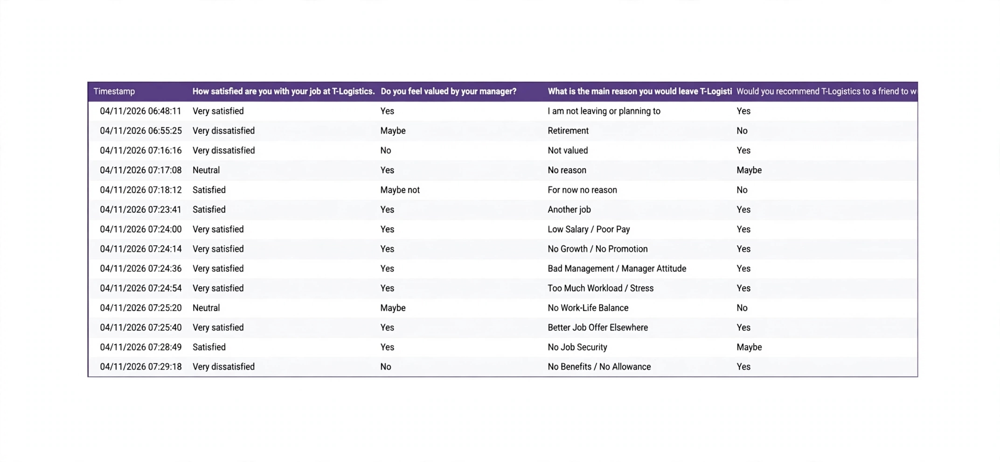
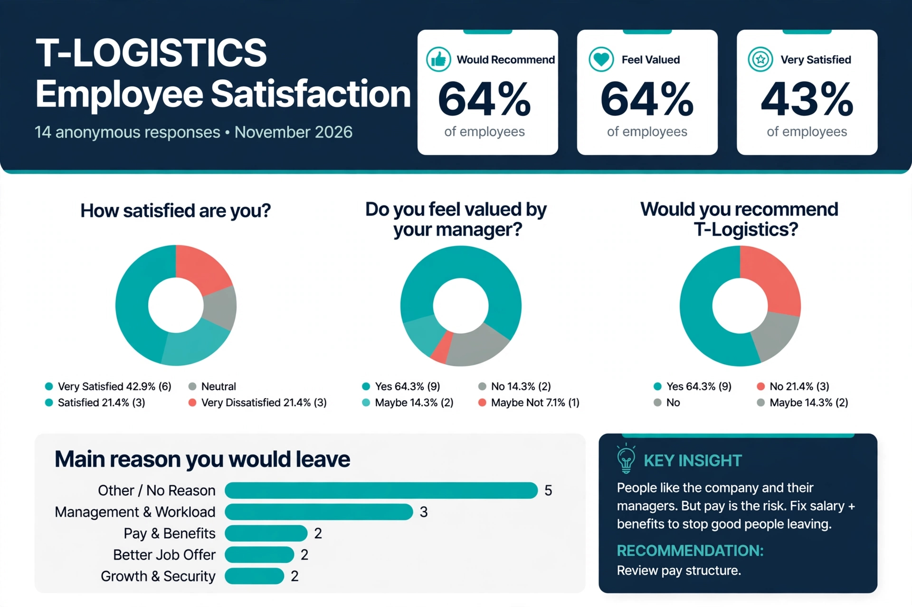
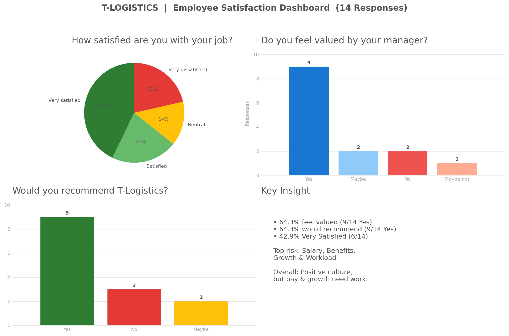

# T-logistics-employee-satisfaction-survey
T-logistics-employee-satisfaction-survey- why people stay or leave
# T-Logistics Employee Satisfaction Survey

I wanted to know the real reason people stay or leave at T-Logistics. So I didn't guess — I asked them.

I built and ran an anonymous survey for 14 employees, analyzed the results, and turned it into clear advice HR can actually use.

## What I Did
- Built the survey in Google Forms (4 sharp questions, no fluff)
- Google Form link i created 
[https://docs.google.com/forms/d/e/1FAIpQLSfQdkKJfHF0lD9-ZRTuJcwl4ELLFeG4Qcy-dq0lU5lMNk1neg/viewform?usp=header]

- Collected 14 anonymous responses
-  — DATA COLLECTED(anonymous)
- Cleaned and analyzed the data in Google Sheets / Excel
- Built a dashboard to show what matters

## What I Asked
1. How satisfied are you with your job?
2. Do you feel valued by your manager?
3. What would make you leave T-Logistics?
4. Would you recommend T-Logistics to a friend?

## What I Found

42.9% are Very Satisfied — the core team is happy

 64.3% feel valued by their manager — management is doing something right

 64.3% would recommend T-Logistics — people still believe in the company
  
  Top risk is money: Low Salary, No Benefits, and Better Job Offers Elsewhere

## My Recommendation to HR
Don't panic. People like the managers and like the company. 
But if pay and benefits don't improve, good people will leave for a better offer. Fix pay first, keep the good culture.

## Tools Used
Google Forms, Google Sheets, Excel, Data Analysis

## Files in This Repo
-  — Visual summary of results
-  — data (anonymous)

## Live Form
 Google Form link i created 
[https://docs.google.com/forms/d/e/1FAIpQLSfQdkKJfHF0lD9-ZRTuJcwl4ELLFeG4Qcy-dq0lU5lMNk1neg/viewform?usp=header]
